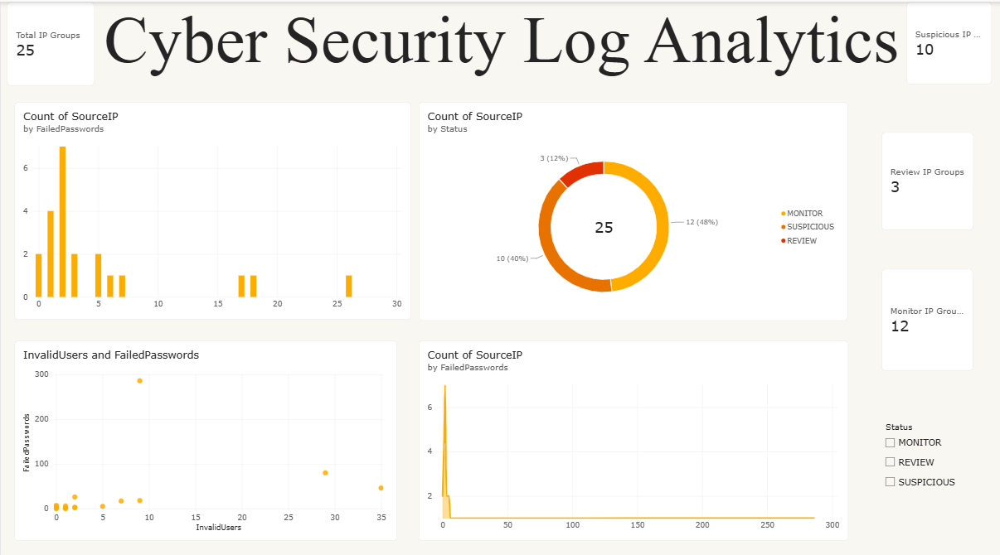

# Distributed SSH Security Log Analyzer

A cloud-based cybersecurity log analytics project that uses **Apache Hadoop MapReduce on AWS EC2** to process OpenSSH authentication logs, aggregate security events by source IP address, and identify potentially suspicious authentication patterns using configurable detection rules.

## Overview

Authentication logs contain valuable information about login attempts, invalid users, and potential unauthorized access. Analyzing these logs manually becomes difficult when dealing with large datasets.

This project implements a distributed log analysis pipeline using Hadoop MapReduce. It processes OpenSSH authentication records, extracts security-related events, groups them by source IP address, and assigns a classification to each IP group based on predefined security rules.

The analysis results are stored in HDFS and visualized through an interactive Power BI dashboard.

## Key Features

- Distributed processing of OpenSSH authentication logs using Hadoop MapReduce.
- Extraction of failed-password attempts, invalid-user events, successful logins, and break-in warnings.
- IP-based aggregation of authentication events.
- Rule-based security classification.
- HDFS-based storage of input data and processing results.
- Power BI dashboard for security event visualization.
- Automated Java tests for log parsing and classification.

## Technology Stack

| Category | Technologies |
|---|---|
| Cloud Platform | AWS EC2 |
| Operating System | Ubuntu Server |
| Big Data Framework | Apache Hadoop 3.4.2 |
| Processing | MapReduce, YARN |
| Programming Language | Java |
| Distributed Storage | HDFS |
| Dataset | OpenSSH Authentication Logs (LogHub) |
| Visualization | Microsoft Power BI |
| Testing | Java Test Classes |

## System Architecture

```text
OpenSSH Authentication Logs
            |
            v
      AWS EC2 Ubuntu
            |
            v
       Hadoop HDFS
            |
            v
    Java MapReduce Mapper
            |
            v
       Event Extraction
            |
            v
    MapReduce Reducer
            |
            v
     IP-Based Aggregation
            |
            v
    Rule-Based Classification
            |
            v
       HDFS Output
            |
            v
      Power BI Dashboard
```

## Log Analysis and Classification

The analyzer extracts four major authentication event categories:

| Event Type | Description |
|---|---|
| Failed Password | Unsuccessful password authentication |
| Invalid User | Login attempt using a non-existent username |
| Successful Login | Successful authentication event |
| Break-in Warning | SSH warning indicating a potential break-in attempt |

### Classification Rules

Each source IP address is assigned a security classification based on aggregated event counts.

| Classification | Detection Condition |
|---|---|
| SUSPICIOUS | Five or more failed-password attempts |
| REVIEW | At least one break-in warning or three or more invalid-user events, unless classified as SUSPICIOUS |
| MONITOR | Does not meet either classification threshold |

These classifications are heuristic indicators for further investigation. They do not independently establish malicious activity.

## Dataset

The project uses OpenSSH authentication logs from the [LogHub Dataset Repository](https://github.com/logpai/loghub).

The sample execution uses 2,000 input log records containing authentication-related events.

## Execution Results

The Hadoop MapReduce job was successfully executed on an AWS EC2 Ubuntu instance.

| Metric | Result |
|---|---:|
| Input Log Records | 2,000 |
| Mapper Output Records | 719 |
| Reducer Output Records | 25 |
| SUSPICIOUS IP Groups | 10 |
| REVIEW IP Groups | 3 |
| MONITOR IP Groups | 12 |

The 25 reducer output records represent aggregated source-IP groups.

*Note: These results represent a particular test execution. They may change when the dataset or implementation is updated.*

## Installation and Execution

### 1. Start the Hadoop Environment

Connect to your AWS EC2 Ubuntu instance and verify Hadoop:

```bash
hadoop version
```

### 2. Check HDFS Input Directory

```bash
hdfs dfs -ls /cybersecurity/input
```

### 3. Execute the MapReduce Job

```bash
hadoop jar security-log-analyzer.jar SecurityLogAnalyzer \
  /cybersecurity/input/OpenSSH.log \
  /cybersecurity/output-analysis
```

Make sure the output directory does not already exist before executing the job.

### 4. View Analysis Results

```bash
hdfs dfs -cat /cybersecurity/output-analysis/part-r-00000
```

### 5. Copy Results to Local Storage

```bash
hdfs dfs -get /cybersecurity/output-analysis/part-r-00000 \
  ~/cybersecurity-log-analytics/analysis-results.txt
```

## Automated Testing

The project includes Java test classes for validating log parsing and security classification.

### Parser Testing

The parser tests cover:

- Failed-password event extraction.
- Invalid-user event extraction.
- Successful public-key login extraction.
- Break-in warning handling.
- Unrelated log filtering.
- Handling security events without source IP addresses.

### Classification Testing

The classification tests validate:

- Failed-password threshold detection.
- Invalid-user event classification.
- Break-in warning classification.
- Normal activity classification.
- Priority handling when multiple security indicators exist.

### Run Tests

Compile the project:

```bash
mkdir -p build tests

javac -classpath "$(hadoop classpath)" -d build \
  src/SecurityClassifier.java \
  src/SecurityLogParser.java \
  src/SecurityLogAnalyzer.java
```

Compile test classes:

```bash
javac -cp build -d tests \
  tests/ClassificationTest.java \
  tests/ParserTest.java
```

Run classification tests:

```bash
java -cp build:tests ClassificationTest
```

Run parser tests:

```bash
java -cp build:tests ParserTest
```

Build the Hadoop JAR:

```bash
jar -cf security-log-analyzer.jar -C build .
```

Current test coverage includes six classification tests and 21 parser checks.

## Power BI Dashboard

An interactive Power BI dashboard presents the results generated by the Hadoop MapReduce pipeline.

### Dashboard Features

- Security classification distribution.
- Failed-password attempts by IP address.
- Invalid-user activity analysis.
- Successful authentication analysis.
- IP-level security investigation table.
- Hadoop MapReduce processing metrics.

### Dashboard Files

- `Cybersecurity-Log-Analytics.pbix` – Power BI report.
- `security-dashboard.png` – Dashboard preview.



## Future Enhancements

- Implement timestamp-based and time-window log analysis.
- Improve support for different OpenSSH log formats.
- Introduce configurable detection thresholds.
- Expand IP address validation.
- Evaluate classification rules using labeled datasets.
- Integrate additional authentication and network security logs.
- Explore anomaly detection techniques for identifying unusual login patterns.

## Limitations

- The current implementation uses predefined heuristic rules rather than machine learning.
- Analysis is based on a sample OpenSSH authentication dataset.
- Classification results require further investigation.
- The current system does not establish whether an IP address is definitively malicious.

## Responsible Use

This project is developed for educational and cybersecurity research purposes. It analyzes sample authentication logs and generates rule-based indicators to support security investigation. Its classifications should not be treated as definitive evidence of malicious activity.

## Author

**Shravani Aney**

[GitHub](https://github.com/AneyShravani)
